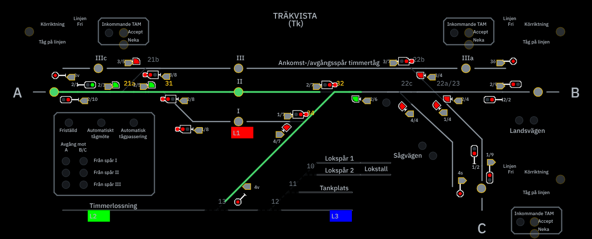

# Träkvista TKL

Ställverk för Träkvista: panelen, huvud- och växeltågvägar, frigivning efter tågets passage, TrainMeet och en egen
anläggningssimulator med LocoNet. Det är samma program som Charlottendal TKL, med Träkvista som station.
Spårplanen, tågvägarna och Bennys JMRI-filer finns i [`stations/trakvista/`](stations/trakvista).



## Installera på en Raspberry Pi

En Raspberry Pi 5 med Raspberry Pi OS 64-bit, eller en annan dator med Debian eller Ubuntu. Kör en rad i terminalen:

```sh
curl -fsSL https://raw.githubusercontent.com/beahead-ab/Tk-TKL/main/install.sh | sudo sh
```

Så länge förrådet är privat behövs en GitHub-token med läsrätt till Tk-TKL (*fine-grained*, Contents: Read). Byt
`TOKEN` mot din token:

```sh
T=TOKEN; curl -fsSL -H "Authorization: Bearer $T" https://raw.githubusercontent.com/beahead-ab/Tk-TKL/main/install.sh | sudo TKL_TOKEN=$T sh
```

Installationen hämtar en egen Node.js 22, lägger programmet i `/opt/tk-tkl` och startar två tjänster som startar av
sig själva när Pi:n startar:

| | |
|---|---|
| Ställverket | `http://127.0.0.1:8910`, tjänsten `tk-tkl` |
| Anläggningssimulatorn | `http://127.0.0.1:8911`, tjänsten `tk-tkl-simulator`, LocoNet över TCP på 8912 |
| Inställningar | `/etc/tk-tkl/app.env`, skrivs en gång och behålls vid uppdatering |
| Driftdata | `/var/lib/tk-tkl` |

På en Pi med skrivbord öppnar Chromium ställverket i helskärm efter nästa omstart (`sudo reboot`), och genvägen
*Träkvista TKL* finns på skrivbordet. Stream Deck kopplas upp av sig själv.

## Uppdatera

I ställverket: när en ny version finns visar statusraden `● Uppdatering` med versionen. Tryck på den, eller gå till
Inställningar → Uppdatering, och välj **Uppdatera nu**. Pi:n hämtar versionen, installerar den och startar om TKL,
vilket tar ett par minuter; sedan visar statusraden `● Ny version · ladda om`. Kunde versionen inte läsas visar
Uppdatering i stället **Hämta senaste versionen**, som gör detsamma.

Så länge förrådet är privat läser Pi:n det med den token som installationen fick (`TKL_TOKEN` på installationsraden);
utan den syns inga nya versioner. Samma sak från terminalen:

```sh
sudo tk-tkl-update
```

Inställningar och driftdata ligger kvar, och svarar den nya versionen inte återställs den föregående. Att köra
installationsraden igen gör detsamma.

## Webbdrift på Render

Träkvista kan också köras som webbdrift, utan egen dator, på [Render](https://render.com):

1. I Render: **New → Blueprint** och välj förrådet `beahead-ab/Tk-TKL`. Render behöver åtkomst till förrådet via sin
   GitHub-app. `render.yaml` i förrådet beskriver tjänsten: `tk-tkl` i Frankfurt, planen Starter och en disk på 1 GB
   för driftdata.
2. Ange ägarens e-post (`TKL_OWNER_EMAIL`) och ett tillfälligt lösenord (`TKL_OWNER_PASSWORD`) när Render frågar.
3. När tjänsten svarar: öppna dess adress, logga in med e-posten och det tillfälliga lösenordet och välj ett eget.
   Fler användare bjuds in under Inställningar → Användare.

Ägaren skapas bara första gången; därefter ligger användarna på disken och variablerna används inte. Render bygger om
tjänsten varje gång Tk-TKL ändras, alltså vid varje publicering, och driftdata ligger kvar. Webbdriften har ingen
LocoNet: TKL svarar själv och kör trafikspelets tåg, och TrainMeet parkopplas i panelen som vanligt. Så länge förrådet
är privat kan Uppdatering i panelen inte läsa versionen utan en token; lägg den i så fall som hemlig fil
`github-token` i Render och sätt `CHARLOTTENDAL_GITHUB_TOKEN_FILE=/etc/secrets/github-token`.

## Koppla till anläggningen och grannarna

- **LocoNet.** Installationen startar mot simulatorn. *Anslut till LocoNet* i panelen kopplar till en LocoBuffer på
  USB; se [LocoNet ansluten eller ej ansluten](docs/loconet-anslutning.md).
- **TrainMeet.** Parkoppla stationen i panelen, som för Charlottendal. Linjerna A (Bilbo), B (Charlottendal) och C
  är ännu inte kopplade till TrainMeet i panelen; se [Kvar för Träkvista](docs/trakvista.md#kvar-för-träkvista).
- **Från en annan dator eller en iPad:** se [docs/raspberry-pi.md](docs/raspberry-pi.md), avsnitt 10.

Allt i [docs/raspberry-pi.md](docs/raspberry-pi.md) gäller Träkvista med `tk-tkl` i stället för `cda-tkl` i namnen.

## Köra på den egna datorn

```sh
npm ci --ignore-scripts
npm start                       # Träkvista: TKL och anläggningssimulatorn på 8910–8912
node --test test/trakvista.test.mjs
```

`npm run import:trakvista` bygger om Träkvistas filer ur `stations/trakvista/Trakvista.xml` och CSV-tabellerna, och
`npm run verify:trakvista` kontrollerar att de är aktuella. Vad som är gjort och vad som är kvar för Träkvista står i
[docs/trakvista.md](docs/trakvista.md).

**Studio** (Inställningar → Studio) visar Träkvista ur dess egna källor: stationsplanen, regelkorten, avvikelselistan,
driftbindningar och mätning, och hela Trakvista.xml post för post under Data → Källa; se
[Studio för Träkvista](docs/trakvista.md#studio-för-träkvista).

## Göra ändringar

1. **Gör en gren och en pull request mot main.** Proven körs av sig själva på varje pull request (fliken *Checks*,
   kontrollen *Prov*). Slå ihop när de är gröna.
2. **Prova lokalt först:**

   ```sh
   npm ci --ignore-scripts
   npm run import:trakvista     # efter ändringar i Trakvista.xml, CSV-tabellerna eller station.json
   npm run verify:trakvista     # de genererade filerna stämmer med källan
   npm test
   ```

3. **Träkvistas filer** ligger i `stations/trakvista/`: källan `Trakvista.xml`, CSV-tabellerna, `station.json` (knappar,
   linjer, lokala växlar och rättelser av källan) och de genererade filerna i `data/` och `profiles/`, som
   `npm run import:trakvista` skriver. Ändra källan eller `station.json`, inte de genererade filerna.
4. **README:** ändra `stations/trakvista/README.md`. README.md i roten skrivs om därifrån vid varje publicering, liksom
   installationsskripten, `package.json`, `packaging/identity.env` och `.github/workflows/prov.yml`.
5. **Ändringar i programmet** (`src/`, `public/`, `scripts/`) gäller även Charlottendal. De tas in där programmet
   utvecklas och kommer tillbaka hit med nästa publicering, se nästa avsnitt.

## Hur Tk-TKL hålls aktuellt

Tk-TKL innehåller programmet och Träkvista. Programmet är detsamma som Charlottendals och publiceras hit därifrån, en
commit per publicering (*Publicerad från cda-tkl …*). En Pi med Träkvista hämtar den nya versionen med
`sudo tk-tkl-update`.

Rättelser som görs här, i programmet eller i `stations/trakvista/`, tas in där programmet utvecklas före nästa
publicering, så att de gäller båda stationerna. Publiceringen stannar om en ändring här inte finns med, så inget skrivs
över. Charlottendal och Träkvista använder samma portar, så kör en station per Pi.
